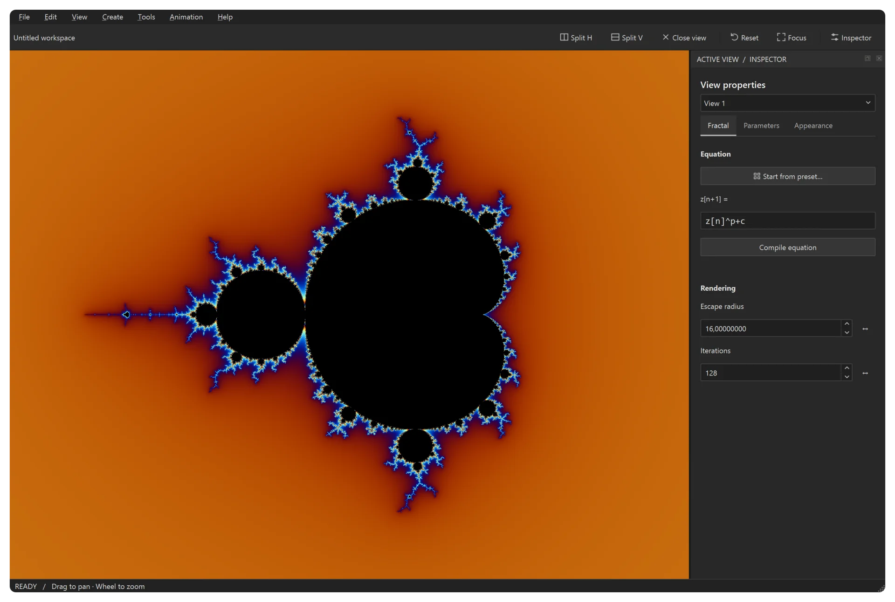
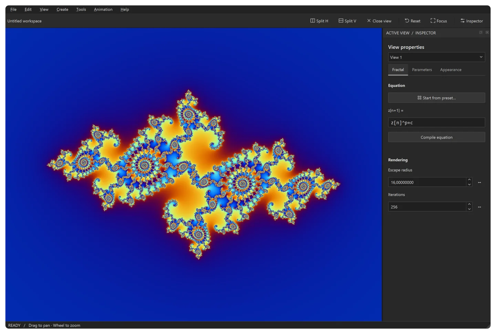
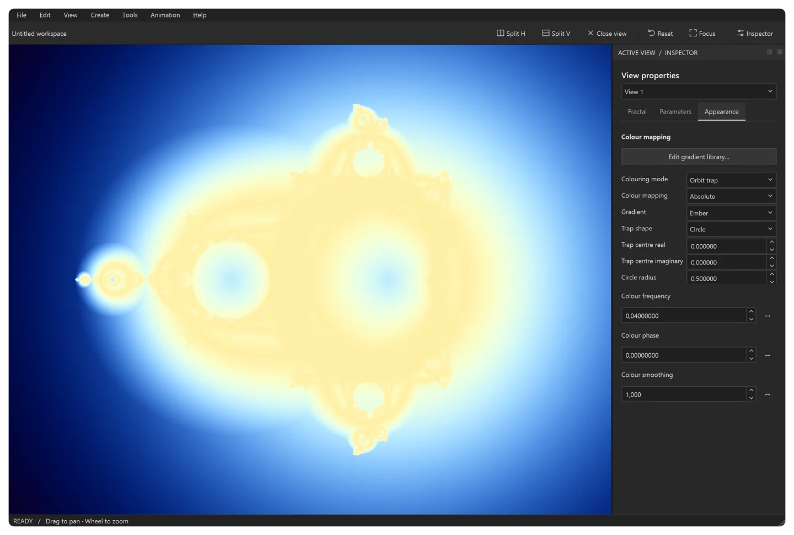

<div align="center">


# Fractal Studio

**Write an equation. Explore its world.**

A native desktop playground for complex dynamics, custom fractals, and orbit-trap art.


[Features](#features) · [Build and run](#build-and-run) · [Equations](#equations) · [Controls](#controls) · [Architecture](#architecture) · [Testing](#testing)

</div>

---

## What is Fractal Studio?

Fractal Studio turns editable complex recurrences into interactive GPU-rendered landscapes. Mandelbrot and Julia are starting points, not fixed rendering modes: change the equation, add named complex variables, split the workspace, and compare the results.

The interface is a compact native Qt workspace with an active-view inspector, floatable variable editor, and independent settings for each numbered view. No browser wrapper, account, or server is required.

## See it in action



| Editable Julia equations | Orbit-trap colouring |
| --- | --- |
|  |  |

These are captures from the running Qt/OpenGL app, not UI mockups. They were captured at 2× display scale, given transparent outer margins and rounded corners, then resized and encoded as WebP with lossless alpha. The app content itself remains unchanged and opaque. The hero is 1920 pixels wide; gallery images are 1440 pixels wide.

## Features

### Explore and experiment

- Editable equations with complex arithmetic, indexed iteration history, and named variables.
- Mandelbrot, Julia, Burning Ship, Tricorn, Cubic Multibrot, and Sine Julia presets.
- Horizontal and vertical view splits, independent cameras, and saved workspace layouts.
- Constant, mouse-picked, and pixel-coordinate variable sources, with configurable picking modifiers and explicit cross-view picking links.
- Separate initial-value settings and per-view negative-history seeds.

### Shape the image

- Independent **Solid / Gradient** controls for escaping and interior points, including binary two-colour output.
- Spectrum, Ember, Ocean, Monochrome, and a shared custom-gradient library.
- Draggable gradient stops, precise stop positions, and colour editing.
- Fixed-point convergence-speed colouring with residual-based colouring for points that have not settled within the iteration budget.
- A separate **orbit-trap mode** with point, circle, and cross traps.
- Absolute or view-scaled mapping, colour phase, frequency, and iteration smoothing.

### Keep your work

- Workspace saving and loading, undo/redo, and PNG export.
- Orbit visualization and parameter animation tools.
- Preset loading and Julia conversion that preserve the target view’s appearance.

## Build and run

### Requirements

- CMake **3.21 or newer** and a C++17 compiler.
- Qt **6.2 or newer**, including Widgets and OpenGLWidgets.
- A desktop OpenGL **4.0** implementation with double-precision shader support.

The UI and renderer use cross-platform Qt/OpenGL APIs. The supplied Windows scripts target **MSYS2 MinGW64** installed at `C:\msys64`; Windows is the currently verified build environment.

### Windows / MSYS2 MinGW64

Install the toolchain and shared Qt packages from an MSYS2 shell:

```sh
pacman -S --needed mingw-w64-x86_64-toolchain mingw-w64-x86_64-cmake mingw-w64-x86_64-qt6-base
```

From a Windows command prompt in the project directory:

```bat
build.bat
run.bat
```

The executable is written to `build-dynamic\fractal.exe`. Builds use **dynamic linking**; `run.bat` adds the MSYS2 runtime directory to `PATH`.

To distribute a Windows build, deploy its matching Qt libraries and platform plugin with `windeployqt`, and include the compiler/runtime dependencies required by your toolchain. Copying the executable alone is not sufficient.

### Other Qt installations

```sh
cmake -S . -B build -DCMAKE_BUILD_TYPE=Release -DCMAKE_PREFIX_PATH=/path/to/Qt
cmake --build build --parallel
./build/fractal
```

For multi-configuration generators, build with `--config Release` and use the executable in the corresponding configuration directory. A compatible Qt development environment and runtime libraries must be available.

## Equations

The recurrence field specifies the right-hand side of **`z[n+1] =`**. The default is:

```text
z[n]^p+c
```

`p` is an ordinary complex variable, initially `2`; it is not a special exponent control. Variables can be added, renamed, and assigned their own sources.

Try imaginary literals and component extraction:

```text
z[n]^p+c+2i
real(z[n])+imag(c)*i
```

**Operators:** `+`, `-`, `*`, `/`, `%`, `^`.

**Functions:** `sin`, `cos`, `exp`, `log`, `conj`, `abs`, `norm`, `floor`, `ceil`, `real`, `imag`.

- `abs` acts on each component; `norm` returns magnitude.
- `real` and `imag` return the selected component as a real-valued complex number.
- `%` requires a nonzero real divisor.
- Built-ins include `pixel`, `i`, `pi`, and the zero-based iteration counter `n`.

### Iteration history

Use `z[index]`, never bare `z` or `z_n`. Each view starts with **History size 1**, retaining only `z[n]`. Increase it explicitly under Parameters when an equation needs older iterates: `z[n-2]` requires a size of at least **3**. Buffer size is never inferred from the equation.

Negative indices default to zero and can have per-view initial-value overrides. `z[0]` comes from the separate Initial z settings. Future, fractional, or expired history accesses render magenta.

## Controls

| Action | Input |
| --- | --- |
| Pan | Left-drag |
| Zoom at cursor | Mouse wheel |
| Pick complex values | Right-drag with the variable’s configured modifiers |
| Reset camera | Home |
| Focus active view | F11 |
| Fullscreen layout | Ctrl+F11 |
| Leave fullscreen | Escape |
| Toggle sidebar | Tab |

Use the workspace header to split or close views. The **View** menu manages panel visibility, and **Help** contains the central usage guide.

## Architecture

```text
Qt Widgets workspace
    ├── Per-view settings, variables, and workspace persistence
    ├── Equation compiler → GLSL → OpenGL renderer
    └── CPU complex evaluator → orbit visualization
```

| Module | Responsibility |
| --- | --- |
| `playground.cpp` | Application entry, theme, and diagnostic commands |
| `mainwindow*.cpp` | Workspace, inspector, menus, presets, and tools |
| `fractal_settings.h` | Per-view equation, variables, and appearance settings |
| `equation.cpp` | Expression parsing and GLSL generation |
| `fractal_view.cpp` | GPU rendering, navigation, picking, and orbit display |
| `workspace.cpp` | CPU complex-expression evaluation |
| `gradient_editor.cpp` | Interactive custom-gradient editor |
| `numeric_slider.cpp` | Configurable numeric controls |
| `regression.cpp` | Integrated regression checks |

## Testing

Build first, then run the integrated smoke suite:

```bat
run.bat --smoke-test
```

Or invoke the executable directly from an environment with the required shared libraries:

```sh
./build/fractal --smoke-test
./build/fractal --capture-ui build/ui-preview.png
```

The suite exercises expression evaluation, shader compilation and rendering, history handling, workspace round-trips, picking, gradients, colour mapping, and rendering-cache behavior. It needs a working Qt/OpenGL environment; it is not a headless CPU-only test suite.

## Limitations

- Bounded does **not** imply convergent. Fixed-point detection and residual-based interior colours are visualization heuristics, not mathematical proofs; periodic orbits need not approach a single fixed point.
- Coordinates use double precision, but shader transcendental functions use float precision. Extremely deep zooms eventually lose detail.
- Escape smoothing uses a quadratic reference and may not suit every custom recurrence.
- Large history buffers can exceed GPU resources. Increase history only as needed.
- View-scaled mapping intentionally changes with the camera span. Absolute mapping is the default.

## Contributing

Keep changes native, cross-platform, and focused. Follow `ATELIER.md`, preserve appearance and dynamic variable names across workspace operations, and run the smoke suite before proposing changes.

## License

No project license has been selected yet. This repository does not currently grant general permission to redistribute or reuse its code. Qt and other dependencies retain their respective licenses.

---

Built for exploring what a small equation can become.
